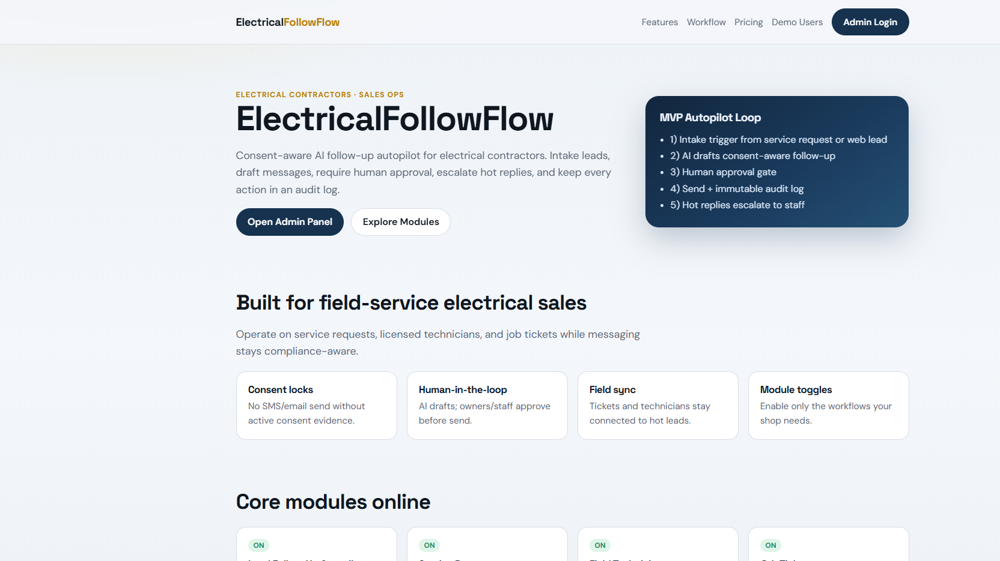
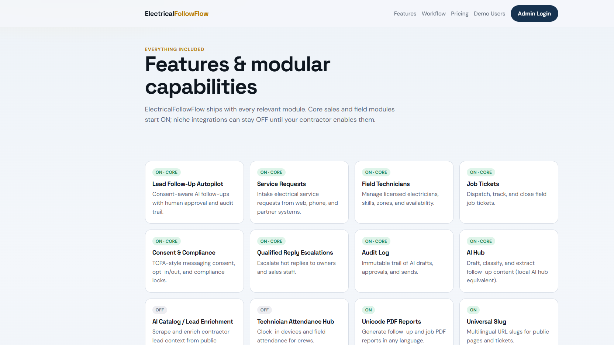
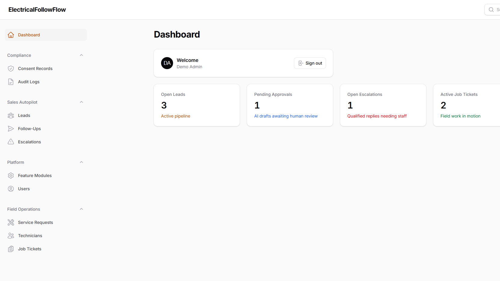
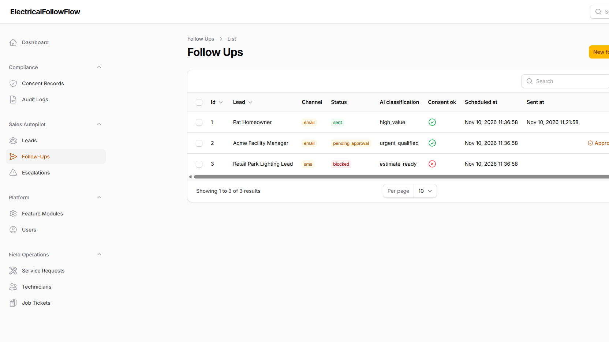

# RoofingFollowFlow — AI Lead Follow-Up Autopilot for Roofing Contractors

**RoofingFollowFlow** is a Laravel + Filament SaaS for roofing contractor sales operations. It generates and sends **consent-aware AI follow-ups**, escalates qualified replies to staff, and operates on **service requests**, **field technicians**, and **job tickets**.

> Rank #25 opportunity · Home & Field Services · Sales operations · Pilot pricing $199–$799/mo

## SEO Keywords / Tags

`roofing contractors`, `roofing contractor CRM`, `lead follow-up autopilot`, `consent-aware messaging`, `TCPA compliance SMS email`, `AI sales automation`, `service requests`, `field technicians`, `job tickets`, `licensed roofing tech dispatch`, `storm damage leads`, `shingle replacement estimates`, `emergency roof leak response`, `hail insurance claims`, `flat roof coating`, `human-in-the-loop AI`, `audit log messaging`, `Jobber integration`, `ServiceTitan integration`, `QuickBooks roofing`, `Google Calendar booking`, `Laravel Filament SaaS`, `modular feature toggles`, `multi-role users`, `owner ops lead staff technician`, `field service automation`, `home services AI`, `USA roofing contractors 2026`, `AI Hub draft classify extract`, `unicode PDF reports`, `universal slug`, `attendance hub`, `Docker Compose Laravel`, `imrandevbd packages equivalents`

## Problem solved

Roofing contractors lose jobs when follow-ups are slow or non-compliant. RoofingFollowFlow runs:

**Intake trigger → AI draft → consent gate → human approval → send → audit log → escalate hot replies**

## Core workflow (MVP)

1. Lead / service request intake
2. AI Hub drafts channel-specific follow-up + classification
3. Consent checked (email/SMS/voice)
4. Owner/staff approve
5. Message marked sent with audit trail
6. Qualified inbound replies escalate to staff

## Feature modules (toggle ON/OFF)

| Module | Default | Notes |
|--------|---------|-------|
| Lead Follow-Up Autopilot | ON (core) | Consent-aware drafts + approval |
| Service Requests | ON (core) | Intake & prioritization |
| Field Technicians | ON (core) | License, zone, specialty |
| Job Tickets | ON (core) | Dispatch & schedule |
| Consent & Compliance | ON (core) | Opt-in evidence & revoke |
| Qualified Reply Escalations | ON (core) | Hot reply routing |
| Audit Log | ON (core) | Immutable action trail |
| AI Hub | ON (core) | Draft / classify / extract |
| Unicode PDF Reports | ON | Follow-up HTML/PDF reports |
| Universal Slug | ON | Multilingual slugs |
| Drutogoti Speed Layer | ON | Timing helpers |
| Admin Panel Extras | ON | KPI widgets |
| Customer / Demo Portal | ON | Demo stakeholder access |
| AI Catalog / Lead Enrichment | OFF | Enrichment stubs |
| Technician Attendance Hub | OFF | Clock in/out |
| Jobber / ServiceTitan / QuickBooks / Google Calendar | OFF | Integration toggles |

Toggle modules in Filament → **Feature Modules**.

> Packagist packages `imrandevbd/*` were not installable as stable public releases at build time. Equivalent local services ship under `app/Services/` (AI Hub, AI Catalog, Attendance Hub, Unicode PDF, Universal Slug, Drutogoti speed).

## Multi-type users

| Role | Demo email | Password |
|------|------------|----------|
| Admin | `admin@roofingfollowflow.test` | `password` |
| Owner | `owner@roofingfollowflow.test` | `password` |
| Staff | `staff@roofingfollowflow.test` | `password` |
| Technician | `tech@roofingfollowflow.test` | `password` |
| Customer | `customer@roofingfollowflow.test` | `password` |

Admin panel: [http://localhost:8125/admin](http://localhost:8125/admin)

## Public pages

- `/` — Home / product story
- `/features` — All modules ON/OFF
- `/workflow` — Autopilot loop
- `/pricing` — Pilot plans
- `/demo` — Demo credentials

## Screenshots









## Docker run

```bash
docker compose up -d --build
```

App: **http://localhost:8125**  
MySQL host port: `33095` · Redis host port: `63815`

Stop:

```bash
docker compose down
```

## Tech stack

- PHP 8.4 · Laravel 13 · Filament 4
- MySQL 8 · Redis 7 (optional)
- Docker Compose
- Modular config + DB-backed feature flags
- Local AI Hub equivalent for draft/classify/escalate

## Integrations (module flags)

Jobber · ServiceTitan · QuickBooks · Google Calendar — toggles ready; wire credentials when enabling.

## Risk / compliance

MED — messaging consent, licensing and safety. Sends are blocked without active consent; approvals are human-gated; actions are audited.

## Contact / Hire

- Developer: Imran Ahmed (IMRAN Dev BD)
- Website: https://imrandev.bd/contact
- Email: me@imrandev.bd
- GitHub: https://github.com/imranbru99
